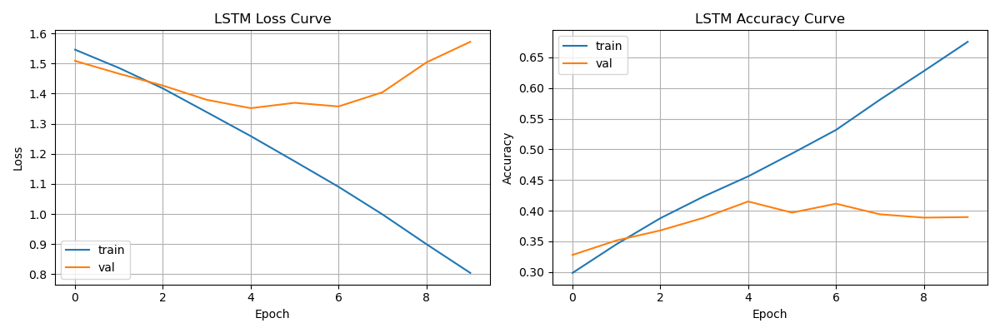
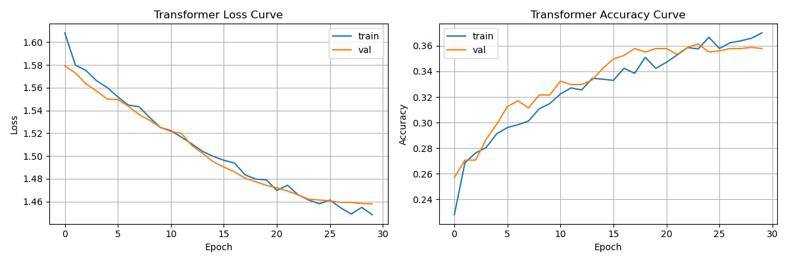
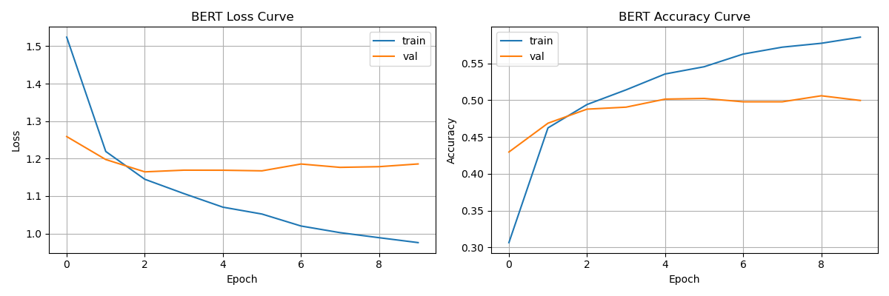

# SST-5 细粒度情感分析：LSTM、Transformer 与 BERT 对比

## 一、项目简介

本项目在 SST-5 数据集上完成五级情感分类任务（非常负面 / 负面 / 中性 / 正面 / 非常正面），对比三种模型：

1. **LSTM**：从零实现双向 LSTM
2. **Transformer**：从零实现 Multi-Head Self-Attention（小模型）
3. **BERT**：基于预训练 BERT 的迁移学习（冻结前 10 层）

这是三个情感分析项目中**难度最高**的一个，目标是理解细粒度分类的挑战、低数据场景下的过拟合问题，以及预训练在数据稀缺时的价值。

## 二、项目结构

```
SST5-project/
├── data/                      # SST-5 数据集（自动下载）
├── models/                    # 保存的模型权重
│   ├── best_lstm.pth
│   ├── best_transformer.pth
│   └── best_bert.pth
├── results/                   # 训练曲线
│   ├── lstm_training_curve.png
│   ├── transformer_training_curve.png
│   └── bert_training_curve.png
├── data_utils.py              # 数据加载、词表构建（LSTM / Transformer 共用）
├── train_lstm.py              # 双向 LSTM
├── train_transformer.py       # 从零 Transformer（小模型）
├── train_bert.py              # BERT 迁移学习
└── README.md
```

## 三、数据集

**SST-5**：斯坦福情感树库，电影评论句子的五级情感分类。

- 类别：非常负面 / 负面 / 中性 / 正面 / 非常正面
- 训练集：8544 条
- 验证集：1101 条
- 测试集：2210 条
- 句子长度：15-20 词（极短）

**和之前项目的对比**：

| 维度 | IMDB | AG News | SST-5 |
|---|---|---|---|
| 类别数 | 2 | 4 | **5（有序）** |
| 文本长度 | 200-300 词 | 30-50 词 | **15-20 词** |
| 训练样本 | 22500 | 108000 | **8544** |
| 类别边界 | 中 | 清晰 | **模糊** |

**SST-5 的核心难点**：

1. **类别边界模糊**：区分"正面"和"非常正面"很难
2. **数据量极小**：只有 8544 条训练数据
3. **文本极短**：15-20 个词，信息量少
4. **人类标注一致性低**：约 60-70%，不同标注者可能给出不同标签

## 四、实验一：双向 LSTM

### 4.1 模型结构

```
输入 [batch, 32]
  ↓ Embedding (8196 → 128)
  ↓ 双向 LSTM (128 → 128×2)
  ↓ Masked Mean Pooling
  ↓ Dropout(0.3) + Linear(256 → 5)
```

- 参数量：1,314,565

### 4.2 训练配置

| 配置 | 值 |
|---|---|
| 优化器 | Adam, lr=1e-3, weight_decay=1e-4 |
| 损失函数 | CrossEntropyLoss |
| Batch size | 32 |
| Max length | 32 |
| 梯度裁剪 | max_norm=1.0 |
| 早停 | patience=5 |
| Epochs | 最多 20 |

### 4.3 结果

| 指标 | 值 |
|---|---|
| 最佳验证准确率 | 41.51% |
| 测试准确率 | **39.82%** |
| 测试损失 | 1.3579 |

### 4.4 训练曲线



### 4.5 正则化消融实验

这是 SST-5 项目最有价值的实验之一。我做了两组对比：

| 配置 | train acc | val acc | 测试准确率 | 问题 |
|---|---|---|---|---|
| dropout=0.5, wd=1e-3 | 48.14% | 39.96% | 40.41% | **欠拟合** |
| dropout=0.3, wd=1e-4 | 67.54% | 41.51% | 39.82% | **过拟合** |

**关键发现**：

- **强正则化**：训练准确率只有 48%，模型学不动，欠拟合
- **弱正则化**：训练准确率 67.5%，验证准确率停滞，过拟合
- **两端都试过了，最佳点在中间**，但测试准确率始终在 40% 左右

**结论**：SST-5 上 LSTM 的测试准确率上限约 40%，正则化强度影响训练过程但不影响泛化上限。

## 五、实验二：从零 Transformer

### 5.1 模型结构

**小模型配置**（因为数据量小）：

```
输入 [batch, 32]
  ↓ Embedding (8196 → 64) + 位置编码
  ↓ Transformer Encoder Block × 1
      ├── Multi-Head Self-Attention (2 头)
      ├── 残差 + LayerNorm (Pre-Norm)
      ├── Feed-Forward (64 → 128 → 64)
      └── 残差 + LayerNorm
  ↓ LayerNorm
  ↓ Masked Mean Pooling
  ↓ Dropout(0.3) + Linear(64 → 5)
```

- 参数量：560,517

**关键改动**（相比 AG News）：

| 参数 | AG News | SST-5 | 原因 |
|---|---|---|---|
| d_model | 128 | **64** | 数据少，减小容量 |
| num_heads | 4 | **2** | 配合 d_model |
| num_layers | 2 | **1** | 数据少，减少深度 |
| dropout | 0.1 | **0.3** | 强正则化 |

### 5.2 训练配置

| 配置 | 值 |
|---|---|
| 优化器 | Adam, lr=3e-4, weight_decay=1e-4 |
| 学习率调度 | Warmup(15%) + 线性衰减 |
| Batch size | 32 |
| Max length | 32 |
| 梯度裁剪 | max_norm=1.0 |
| 早停 | patience=5 |
| Epochs | 30（实际跑满 30 个） |

### 5.3 结果

| 指标 | 值 |
|---|---|
| 最佳验证准确率 | 35.79% |
| 测试准确率 | **35.34%** |
| 测试损失 | 1.4646 |

### 5.4 训练曲线



### 5.5 关键观察

- **训练准确率只有 37%**，模型连训练集都没拟合好
- 这是**欠拟合**，不是过拟合
- Transformer 在 8544 条数据上无法学到足够的注意力模式

**结论**：SST-5 上从零 Transformer 测试准确率 35.34%，低于 LSTM 的 40.41%。数据量太少，Transformer 缺少归纳偏置，无法发挥优势。

## 六、实验三：BERT 迁移学习

### 6.1 模型结构

```
输入 [batch, 32]
  ↓ BERT Tokenizer（子词级）
  ↓ BERT Encoder × 12（冻结前 10 层）
  ↓ 取 [CLS] token 输出
  ↓ Dropout(0.3) + Linear(768 → 5)
```

- 总参数量：109,486,085
- 可训练参数量：14,770,181（13.5%）

### 6.2 关键：冻结更多层

```python
# 冻结 embeddings 和前 10 层（只训练最后 2 层 + 分类头）
for param in self.bert.embeddings.parameters():
    param.requires_grad = False
for i in range(freeze_layers):
    for param in self.bert.encoder.layer[i].parameters():
        param.requires_grad = False
```

**为什么冻结 10 层**：SST-5 只有 8544 条数据，冻结更多层能大幅减少过拟合。可训练参数只有 1477 万（13.5%），模型容量被限制住。

### 6.3 训练配置

| 配置 | 值 |
|---|---|
| 优化器 | AdamW, lr=2e-5, weight_decay=0.01 |
| 学习率调度 | Warmup(10%) + 线性衰减 |
| Batch size | 32 |
| Max length | 32 |
| 梯度裁剪 | max_norm=1.0 |
| 早停 | patience=3 |
| Epochs | 最多 10 |

### 6.4 结果

| 指标 | 值 |
|---|---|
| 最佳验证准确率 | 50.59% |
| 测试准确率 | **50.72%** |
| 测试损失 | 1.1393 |

### 6.5 训练曲线



### 6.6 关键观察

- **第 1 个 epoch val acc 就到 42.96%**，比 LSTM 训练 20 个 epoch 的结果（40.41%）还高
- 第 6 个 epoch 达到最佳 50.23%
- 训练准确率只到 58.5%，说明没有严重过拟合
- 冻结 10 层有效限制了模型容量

## 七、三个模型对比

### 7.1 最终结果

| 模型 | 训练方式 | 参数量 | 测试准确率 |
|---|---|---|---|
| Transformer | 从零训练 | 56 万 | 35.34% |
| LSTM | 从零训练 | 131 万 | 40.41% |
| **BERT** | **预训练 + 冻结微调** | **1.09 亿** | **50.72%** |

### 7.2 核心结论

1. **BERT 显著领先**：比 LSTM 高 10.31 个百分点，比 Transformer 高 15.38 个百分点。

2. **从零模型上限约 40%**：LSTM 和 Transformer 都受限于数据量，无法突破 40%。

3. **Transformer 在低数据场景下劣势最大**：只有 8544 条数据，Transformer 缺少归纳偏置，表现最差。

4. **BERT 突破从零模型天花板**：预训练提供的语言知识让 BERT 在低数据场景下也能到 50%+。

5. **SST-5 难度极高**：5 分类随机猜 20%，人类标注一致性仅 60-70%，BERT 的 50.72% 已接近公开基准水平（SOTA 约 55-60%）。

## 八、跨项目对比：数据量决定架构选择

### 8.1 四个项目的完整对比

| 项目 | 训练数据 | LSTM | Transformer | BERT |
|---|---|---|---|---|
| IMDB | 22500 | 86.46% | 83.34% | 91.34% |
| AG News | 108000 | 91.47% | 91.33% | 94.55% |
| SST-5 | 8544 | 40.41% | 35.34% | 50.72% |

### 8.2 关键规律

**规律 1：数据量决定 Transformer vs LSTM**

| 项目 | 训练数据 | Transformer - LSTM |
|---|---|---|
| AG News | 108000 | -0.14%（打平） |
| IMDB | 22500 | -3.12%（LSTM 领先） |
| SST-5 | 8544 | **-5.07%（LSTM 大幅领先）** |

**数据越少，Transformer 相比 LSTM 的劣势越大。**

**规律 2：数据量决定预训练的价值**

| 项目 | 训练数据 | BERT - 最好从零模型 |
|---|---|---|
| AG News | 108000 | +3.1% |
| IMDB | 22500 | +4.9% |
| SST-5 | 8544 | **+10.3%** |

**数据越少，预训练的价值越大。**

### 8.3 总结

> **架构选择取决于任务和数据规模。数据量不足时，LSTM 的归纳偏置更有优势，Transformer 表现最差；数据量充足时，Transformer 能追平 LSTM；而预训练的 BERT 在数据越少时优势越大，因为预训练已经把语言知识"存"在参数里了。**

## 九、个人思考与踩坑记录

### 9.1 关于细粒度分类

- 5 个类别是有序的（非常负面 → 非常正面），但普通 CrossEntropy 忽略了这种顺序关系
- 相邻类别之间的边界模糊，模型容易混淆"正面"和"非常正面"
- 可以考虑有序回归或软标签来改进

### 9.2 关于正则化的两端

SST-5 上做正则化消融实验，发现：

- 强正则化（dropout=0.5, wd=1e-3）：欠拟合，训练准确率只有 48%
- 弱正则化（dropout=0.3, wd=1e-4）：过拟合，训练准确率 67.5% 但验证停滞
- **正则化的最佳点在中间，但泛化上限由数据量决定**

**这个发现比"我调到了 40%"更有价值。**

### 9.3 关于低数据场景

- 数据量是模型性能的硬约束
- 从零模型在 SST-5 上无法突破 40%
- 预训练是突破这个限制的关键

### 9.4 关于 Transformer 的局限

- Transformer 需要大量数据才能发挥优势
- 在 8544 条数据上，连训练集都拟合不好（训练准确率只有 37%）
- **架构选择必须考虑数据规模**

### 9.5 关于标注一致性

SST-5 上人类标注一致性只有约 60-70%，意味着：

- 模型即使完全理解句子，也可能和标注不一致
- **50.72% 不是失败，是 SST-5 本身难度决定的**

## 十、如何运行

```bash
# 安装依赖
pip install torch transformers datasets tqdm matplotlib numpy

# 训练 LSTM
python train_lstm.py

# 训练从零 Transformer
python train_transformer.py

# 训练 BERT
python train_bert.py
```

设备支持：CUDA / MPS（Mac M 芯片）/ CPU

## 十一、参考

- [SST-5 数据集](https://huggingface.co/datasets/SetFit/sst5)
- [BERT 论文](https://arxiv.org/abs/1810.04805)
- [Attention Is All You Need](https://arxiv.org/abs/1706.03762)
- Stanford CS224n